# Chaojifeng's Video Design Methodology

A Skill that helps AI Agents design and produce videos. Turn topics, products, and source assets into editable storyboards and production plans; coordinate shots, text, narration, music, and pacing; then handle previews, reviews, revisions, and final delivery.

Suitable for product demos, educational explainers, music-based education, educational rap videos, news, photo-based videos, stories, and brand shorts. You can also use it just for a concept, storyboard, a single animation, or a targeted edit to an existing work.

| Video Tasks | Available Styles | Included Samples | Basic Animations | Expression Techniques | Composition Recipes |
| --- | --- | --- | --- | --- | --- |
| **8 types** | **66 styles** | **59 videos** | **12 types** | **64 techniques** | **18 recipes** |

Production uses the tools already available in your project. Rendering, voice generation, and export depend on the environment running the Skill.

[Get Started](#getting-started) · [Capabilities & Origins](#where-the-capabilities-come-from) · [Seven Core Styles](#seven-core-styles-maintained-by-this-repository) · [59 Integrated Styles](#59-open-source-integrated-film-styles) · [Style Gallery](assets/gallery/index.html)

<a id="能力从哪里来"></a>
## Where the Capabilities Come From

This repository brings together creative methods, style resources, and production tools. The table below clarifies where each component comes from and how to extend it.

| Component | Origin & Maintenance | What It Provides |
| --- | --- | --- |
| Directing methods, scene orchestration, expression catalog, and composition recipes | Original synthesis and adaptation of creative practice and external research | Plan the narrative, shots, evidence, sound, and revisions around what viewers need to understand |
| 7 core styles | Existing configurations and rules maintained by this repository | Starting points for product, editorial, diagrammatic, photographic, collage, and launch videos |
| 59 film styles, representative frames, examples, and samples | Integrated from [LemoLab · Lemo-Opuscar](https://github.com/lemomo-ai/lemo-opuscar) | Additional approaches including ink wash, printmaking, documentary, pixels, cartoons, materials, and 3D |
| Unified style packs, Chinese-language lookup, external collections, and offline gallery | Independently adapted after studying Lemo-Opuscar's engineering structure | Find, compare, derive, and reuse original and integrated styles in one catalog |
| Plan and delivery specifications, asset and media checks, audio event audits | Independently implemented in this repository | Validate timing, references, files, actual media properties, and delivery completeness |

The repository's original contributions focus on method synthesis, task orchestration, configuration, plan specifications, tooling, and practical examples. Directing and design methods also draw on community projects and creators. See [Method Sources](references/sources.md) for attribution and implementation distinctions.

## 8 Types of Video Tasks

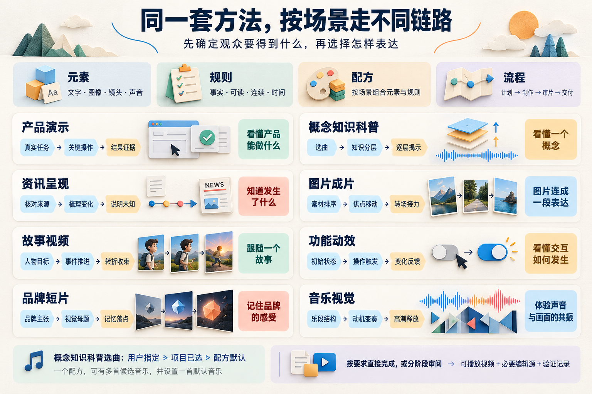

| Scenario | Content Structure | Audience Takeaway |
| --- | --- | --- |
| Product demo | Real task → key actions → proof of results | Understand what a product can do |
| Educational explainer | Verify facts → establish relationships → explain layer by layer | Understand a concept, relationship, or process |
| News & information | Verify sources → trace developments → organize evidence | Understand what happened |
| Photo-based video | Sequence assets → shift focus → connect transitions | Experience a cohesive narrative through images |
| Story video | Character's goal → unfolding events → turning point and resolution | Follow a story |
| Feature animation | Initial state → user action → feedback and change | Understand how an interaction works |
| Brand short | Brand proposition → visual motif → memorable conclusion | Remember the brand's identity and feel |
| Music & visual performance | Musical structure → motif variation → climactic release | Experience the interplay of sound and image |

Educational explainers include both concept explainers and hip-hop explainers. Depending on the subject, narration, music, lyrics, processes, or relationships can lead the edit.

## Directing & Production Capabilities

| Capability | How to Use It | Further Reading |
| --- | --- | --- |
| Narrative throughline and shot design | Define the viewer's change in understanding, focal point of each shot, reveal order, readable holds, and handoffs | [Creative Direction](references/creative-direction.md) |
| Opening frame and first three seconds | Establish the subject, task, or change immediately; assess focus and information density | [Opening Design](references/opening-design.md) |
| Proof through real product tasks | Show authentic operations, interface states, results, and comparisons | [Product Expression](references/product-expression.md) |
| Concept explainers | Organize facts, relationships, visual carriers, and progressive reveals around real music and reading time | [Knowledge & Music Direction](references/knowledge-music-direction.md) |
| Hip-hop explainers | Verify facts and singable lyrics before aligning visuals, captions, and sound to the actual audio | [Knowledge & Rap Direction](references/knowledge-rap-direction.md) |
| Narration, captions, and music | Measure actual audio duration first, then coordinate musical sections, lead audio, effects, captions, and edits | [Sound & Rhythm](references/sound-and-rhythm.md) |
| Asset selection and orchestration | Assign clear roles to screen recordings, photos, footage, graphics, generated assets, and 3D | [Asset Routing](references/asset-routing.md) |
| Targeted revisions and review | Edit by shot, object, or time window; recheck affected captions, audio cues, and transitions | [Review & Revision](references/review-and-revision.md) |
| Continuous production or staged approval | Finish end to end when expressly requested, or pause at agreed storyboard review points | [Production Workflow](references/production-workflow.md) |

<a id="本库维护的七套基础风格"></a>
## Seven Core Styles Maintained by This Repository

These styles retain their original IDs. Use them as starting points, then combine them with the techniques and recipes below.

| Core Style | Visual Direction | Best Suited For |
| --- | --- | --- |
| [Product Minimal](styles/product-minimal/STYLE.md) | Restrained whitespace emphasizing interface and actions | Product introductions, feature demos, task proof |
| [Paper Editorial](styles/paper-editorial/STYLE.md) | Print-like reading and editorial layouts | Educational explainers, source analysis, reading-focused work |
| [Dark Tech](styles/dark-tech/STYLE.md) | Dark environments with clear information hierarchy | Technical explanations, information flows, state changes |
| [Mono Diagram](styles/mono-diagram/STYLE.md) | Relationships conveyed through position, lines, and monochrome emphasis | System mechanics, workflows, concept explanations |
| [Cinematic Photo](styles/cinematic-photo/STYLE.md) | Photography and footage carry the narrative | People, travel, photo montages, visual stories |
| [Vivid Collage](styles/vivid-collage/STYLE.md) | Cutout imagery, bold color, and scale shifts | Rhythmic shorts, events, brands, music visuals |
| [Dual-Ground Launch](styles/dual-ground-launch/STYLE.md) | Two background colors connect problem and answer | Product launches, feature chapters, before-and-after tasks |

## Creative Examples & Practical Experience

### Small Rounded Corners

https://github.com/user-attachments/assets/d87f8264-0a95-40d6-adbb-4e7e0afa32d3

A 22-second vertical clip combining a sliding corner-radius adjustment, a nine-image batch operation, and a rotating ring of cards. Click the player to watch and enable audio using the volume control.

### AI Level-Up Journey

https://github.com/user-attachments/assets/bced29b5-a55a-4f92-85a5-865c6730752a

An approximately 18.6-second landscape highlight that connects a startup countdown with a “level-up challenge” chorus. Click the player to watch and enable sound using the volume control.

Both projects were created collaboratively in Cursor. See [Showcase Notes](examples/showcase/README.md) for clip selection, methods, and creative sources.

<a id="开源集成的-59-套影片风格"></a>
## 59 Open-Source Integrated Film Styles

The following styles, representative frames, and samples come from [LemoLab · Lemo-Opuscar](https://github.com/lemomo-ai/lemo-opuscar). Thanks to the authors for sharing their work openly. This repository incorporates them into unified style packs and its catalog while retaining rules, example descriptions, available text source files, and sample videos for selection and adaptation.

Click an image to inspect the style rules, or click “Sample video” to open a video in the repository. All 59 samples are included and can be viewed offline in the [Style Gallery](assets/gallery/index.html) after downloading the full repository. Three retain their visuals but have restricted audio tracks removed. See the [Third-Party Notices](THIRD_PARTY_NOTICES.md) for sources and changes.

### Editing & Documentary · 8 Styles

<table>
<tr>
<td width="33%" valign="top"><a href="styles/opuscar-caption-news/STYLE.md">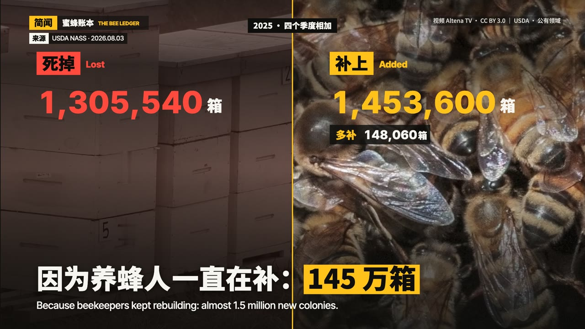</a><br><b>Caption News</b><br><sub>Caption News</sub><br><sub>News & Information / Story Videos / Photo Videos</sub><br><a href="styles/opuscar-caption-news/STYLE.md">Style rules</a> · <a href="styles/opuscar-caption-news/sample.mp4">Sample video</a></td>
<td width="33%" valign="top"><a href="styles/opuscar-city-symphony/STYLE.md">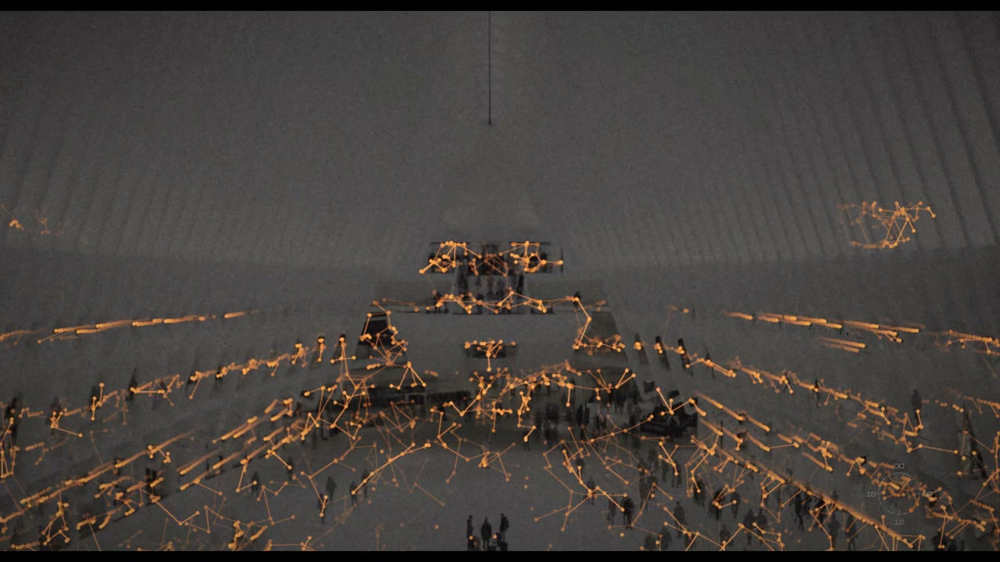</a><br><b>Time-lapse Symphony</b><br><sub>Time-lapse Symphony</sub><br><sub>News & Information / Story Videos / Photo Videos</sub><br><a href="styles/opuscar-city-symphony/STYLE.md">Style rules</a> · <a href="styles/opuscar-city-symphony/sample.mp4">Sample video</a></td>
<td width="33%" valign="top"><a href="styles/opuscar-countdown/STYLE.md">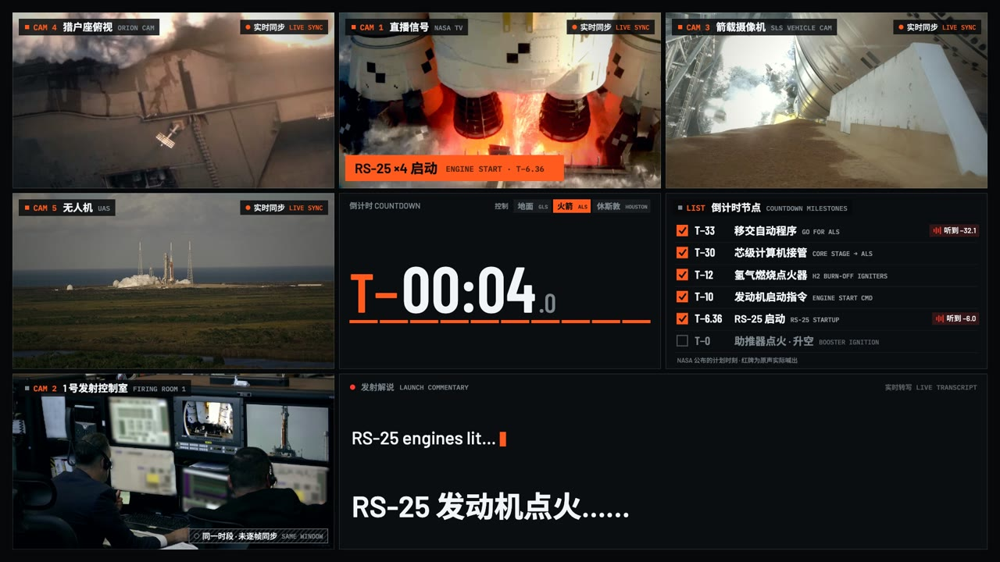</a><br><b>Live Countdown Split-screen</b><br><sub>Live Countdown Split-screen</sub><br><sub>News & Information / Story Videos / Photo Videos</sub><br><a href="styles/opuscar-countdown/STYLE.md">Style rules</a> · <a href="styles/opuscar-countdown/sample.mp4">Sample video</a></td>
</tr>
<tr>
<td width="33%" valign="top"><a href="styles/opuscar-kino-montage/STYLE.md">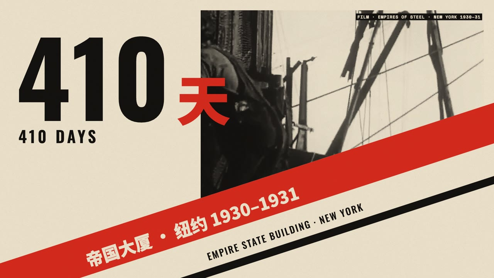</a><br><b>Constructivist Montage</b><br><sub>Constructivist Montage</sub><br><sub>News & Information / Story Videos / Photo Videos</sub><br><a href="styles/opuscar-kino-montage/STYLE.md">Style rules</a> · <a href="styles/opuscar-kino-montage/sample.mp4">Sample video</a></td>
<td width="33%" valign="top"><a href="styles/opuscar-news-package/STYLE.md">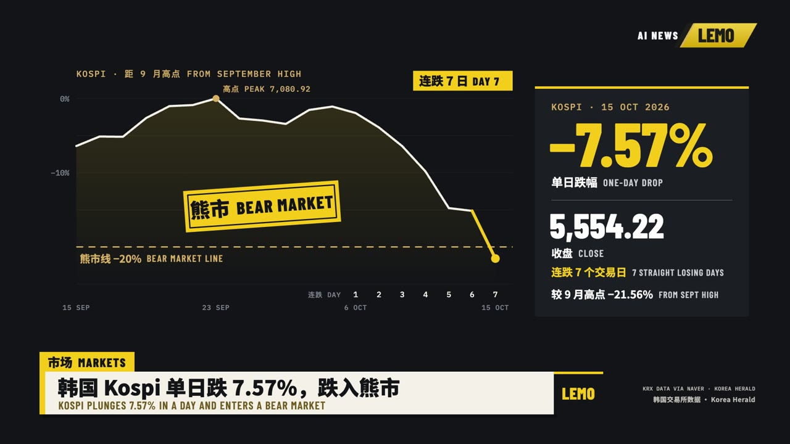</a><br><b>Broadcast News Package</b><br><sub>Broadcast News Package</sub><br><sub>News & Information / Story Videos / Photo Videos</sub><br><a href="styles/opuscar-news-package/STYLE.md">Style rules</a> · <a href="styles/opuscar-news-package/sample.mp4">Sample video</a></td>
<td width="33%" valign="top"><a href="styles/opuscar-newsreel/STYLE.md">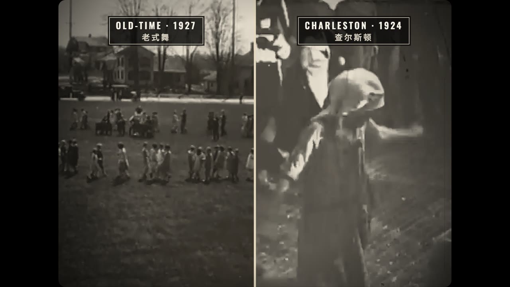</a><br><b>1920s Newsreel</b><br><sub>1920s Newsreel</sub><br><sub>News & Information / Story Videos / Photo Videos</sub><br><a href="styles/opuscar-newsreel/STYLE.md">Style rules</a> · <a href="styles/opuscar-newsreel/sample.mp4">Sample video</a></td>
</tr>
<tr>
<td width="33%" valign="top"><a href="styles/opuscar-telestrator/STYLE.md">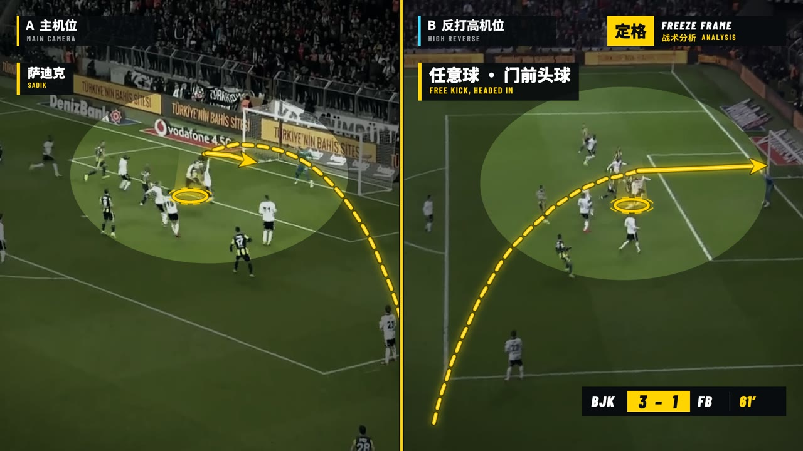</a><br><b>Sports Telestrator</b><br><sub>Sports Telestrator</sub><br><sub>News & Information / Story Videos / Photo Videos</sub><br><a href="styles/opuscar-telestrator/STYLE.md">Style rules</a> · <a href="styles/opuscar-telestrator/sample.mp4">Sample video</a></td>
<td width="33%" valign="top"><a href="styles/opuscar-visual-investigation/STYLE.md">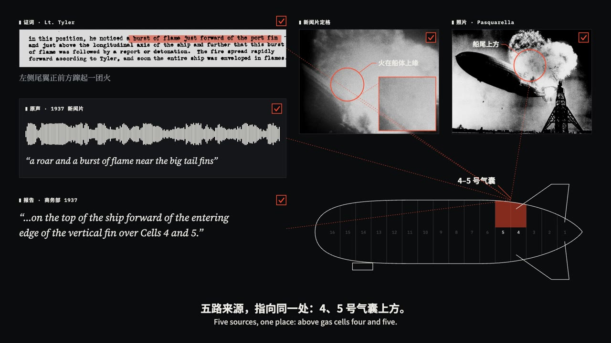</a><br><b>Visual Investigation</b><br><sub>Visual Investigation</sub><br><sub>News & Information / Story Videos / Photo Videos</sub><br><a href="styles/opuscar-visual-investigation/STYLE.md">Style rules</a> · <a href="styles/opuscar-visual-investigation/sample.mp4">Sample video</a></td>
</tr>
</table>

### Evidence-Based Visuals · 8 Styles

<table>
<tr>
<td width="33%" valign="top"><a href="styles/opuscar-archive-lighttable/STYLE.md">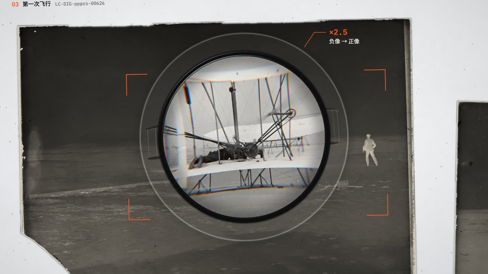</a><br><b>Archive Light Table</b><br><sub>Archive Light Table</sub><br><sub>Educational Explainers / News & Information / Product Demos</sub><br><a href="styles/opuscar-archive-lighttable/STYLE.md">Style rules</a> · <a href="styles/opuscar-archive-lighttable/sample.mp4">Sample video</a></td>
<td width="33%" valign="top"><a href="styles/opuscar-briefing-board/STYLE.md">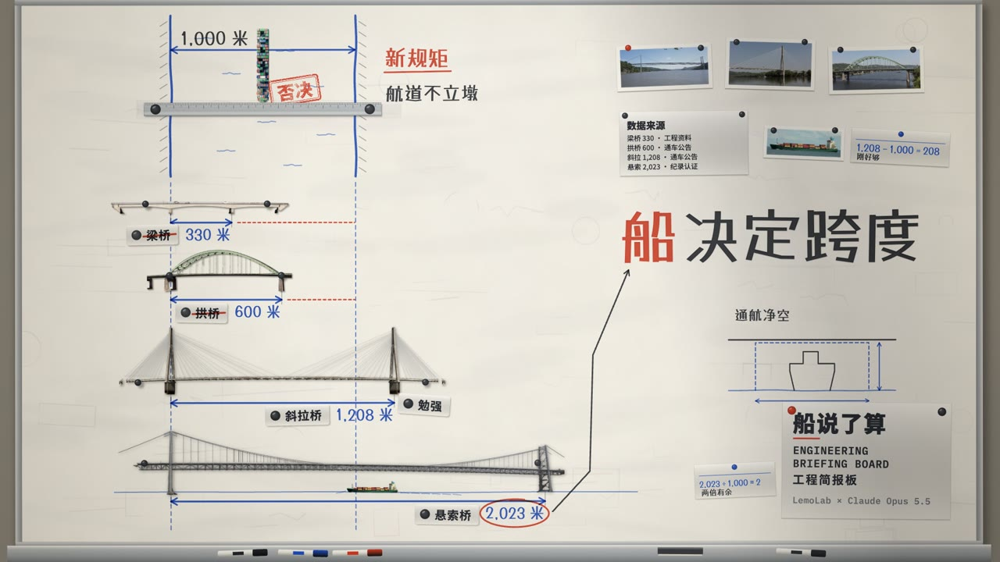</a><br><b>Engineering Briefing Board</b><br><sub>Engineering Briefing Board</sub><br><sub>Educational Explainers / News & Information / Product Demos</sub><br><a href="styles/opuscar-briefing-board/STYLE.md">Style rules</a> · <a href="styles/opuscar-briefing-board/sample.mp4">Sample video</a></td>
<td width="33%" valign="top"><a href="styles/opuscar-data-physical/STYLE.md">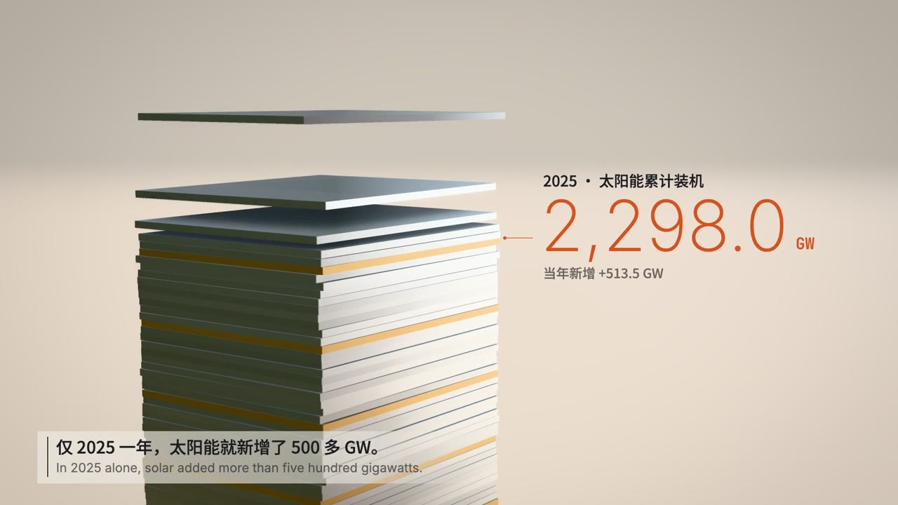</a><br><b>Data Physicalization</b><br><sub>Data Physicalization</sub><br><sub>Educational Explainers / News & Information / Product Demos</sub><br><a href="styles/opuscar-data-physical/STYLE.md">Style rules</a> · <a href="styles/opuscar-data-physical/sample.mp4">Sample video</a></td>
</tr>
<tr>
<td width="33%" valign="top"><a href="styles/opuscar-lidar-survey/STYLE.md">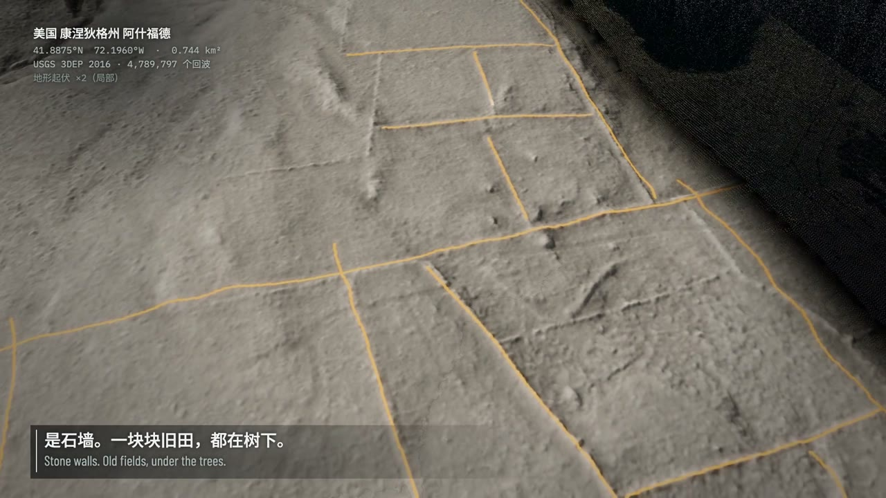</a><br><b>LiDAR Survey</b><br><sub>LiDAR Survey</sub><br><sub>Educational Explainers / News & Information / Product Demos</sub><br><a href="styles/opuscar-lidar-survey/STYLE.md">Style rules</a> · <a href="styles/opuscar-lidar-survey/sample.mp4">Sample video</a></td>
<td width="33%" valign="top"><a href="styles/opuscar-microscope/STYLE.md">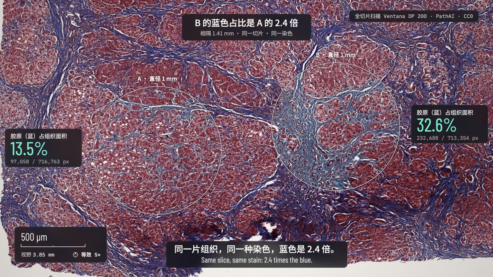</a><br><b>Microscope Story</b><br><sub>Microscope Story</sub><br><sub>Educational Explainers / News & Information / Product Demos</sub><br><a href="styles/opuscar-microscope/STYLE.md">Style rules</a> · <a href="styles/opuscar-microscope/sample.mp4">Sample video</a></td>
<td width="33%" valign="top"><a href="styles/opuscar-satellite-briefing/STYLE.md">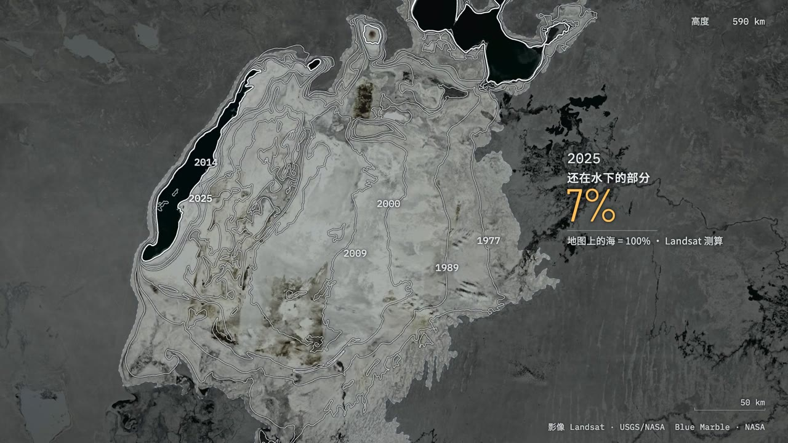</a><br><b>Satellite Briefing</b><br><sub>Satellite Briefing</sub><br><sub>Educational Explainers / News & Information / Product Demos</sub><br><a href="styles/opuscar-satellite-briefing/STYLE.md">Style rules</a> · <a href="styles/opuscar-satellite-briefing/sample.mp4">Sample video</a></td>
</tr>
<tr>
<td width="33%" valign="top"><a href="styles/opuscar-teardown/STYLE.md">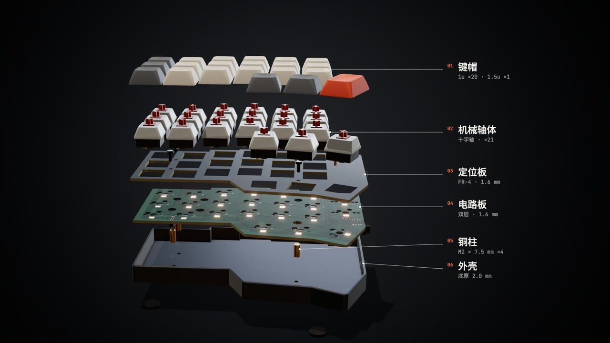</a><br><b>Exploded Teardown</b><br><sub>Exploded Teardown</sub><br><sub>Educational Explainers / News & Information / Product Demos</sub><br><a href="styles/opuscar-teardown/STYLE.md">Style rules</a> · <a href="styles/opuscar-teardown/sample.mp4">Sample video</a></td>
<td width="33%" valign="top"><a href="styles/opuscar-white-model/STYLE.md">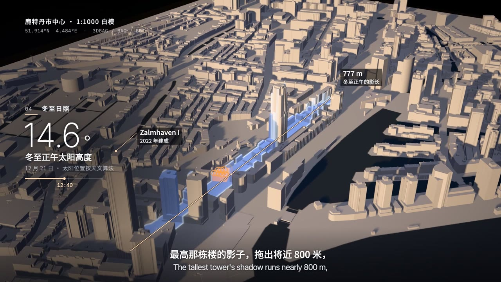</a><br><b>Projection on White Model</b><br><sub>Projection on White Model</sub><br><sub>Educational Explainers / News & Information / Product Demos</sub><br><a href="styles/opuscar-white-model/STYLE.md">Style rules</a> · <a href="styles/opuscar-white-model/sample.mp4">Sample video</a></td>
</tr>
</table>

### Drawing & Painting · 7 Styles

<table>
<tr>
<td width="33%" valign="top"><a href="styles/opuscar-crayon-book/STYLE.md">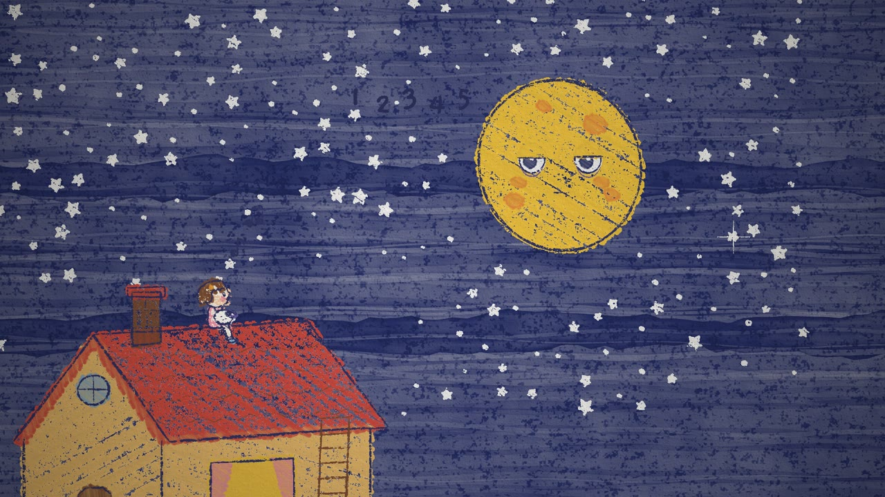</a><br><b>Crayon Picture Book</b><br><sub>Crayon Picture Book</sub><br><sub>Story Videos / Educational Explainers / Brand Shorts</sub><br><a href="styles/opuscar-crayon-book/STYLE.md">Style rules</a> · <a href="styles/opuscar-crayon-book/sample.mp4">Sample video</a></td>
<td width="33%" valign="top"><a href="styles/opuscar-impasto/STYLE.md"></a><br><b>Impasto Oil Painting</b><br><sub>Impasto Oil Painting</sub><br><sub>Story Videos / Educational Explainers / Brand Shorts</sub><br><a href="styles/opuscar-impasto/STYLE.md">Style rules</a> · <a href="styles/opuscar-impasto/sample.mp4">Sample video</a></td>
<td width="33%" valign="top"><a href="styles/opuscar-ink-wash/STYLE.md">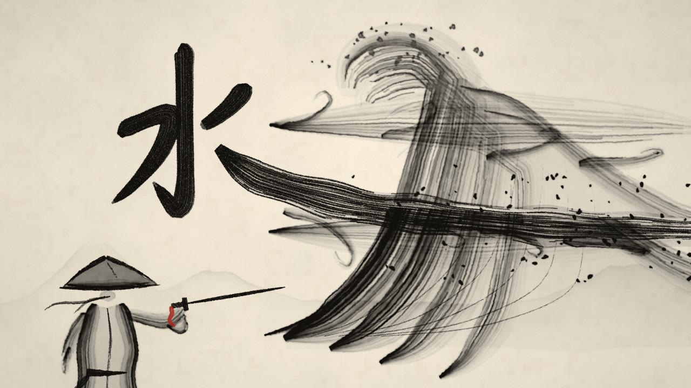</a><br><b>Chinese Ink Wash</b><br><sub>Chinese Ink Wash</sub><br><sub>Story Videos / Educational Explainers / Brand Shorts</sub><br><a href="styles/opuscar-ink-wash/STYLE.md">Style rules</a> · <a href="styles/opuscar-ink-wash/sample.mp4">Sample video</a></td>
</tr>
<tr>
<td width="33%" valign="top"><a href="styles/opuscar-one-line/STYLE.md">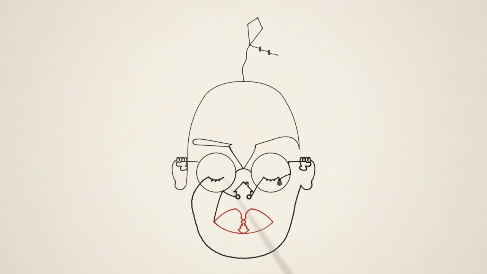</a><br><b>One-line Drawing</b><br><sub>One-line Drawing</sub><br><sub>Story Videos / Educational Explainers / Brand Shorts</sub><br><a href="styles/opuscar-one-line/STYLE.md">Style rules</a> · <a href="styles/opuscar-one-line/sample.mp4">Sample video</a></td>
<td width="33%" valign="top"><a href="styles/opuscar-urban-sketch/STYLE.md">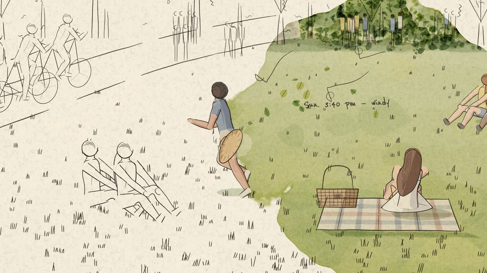</a><br><b>Urban Sketch · Pen &amp; Wash</b><br><sub>Urban Sketch · Pen &amp; Wash</sub><br><sub>Story Videos / Educational Explainers / Brand Shorts</sub><br><a href="styles/opuscar-urban-sketch/STYLE.md">Style rules</a> · <a href="styles/opuscar-urban-sketch/sample.mp4">Sample video</a></td>
<td width="33%" valign="top"><a href="styles/opuscar-watercolor/STYLE.md">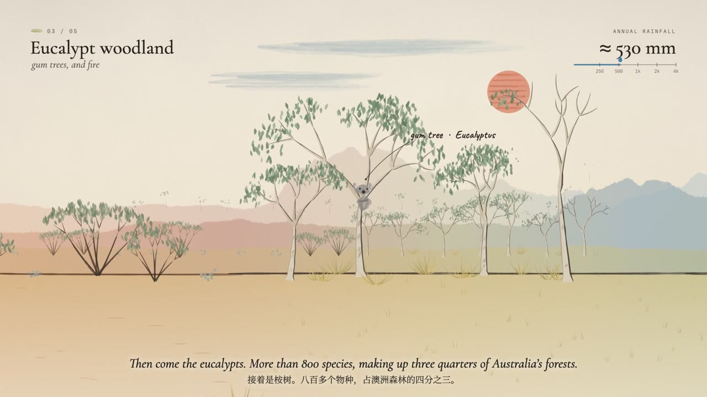</a><br><b>Watercolor Brush</b><br><sub>Watercolor Brush</sub><br><sub>Story Videos / Educational Explainers / Brand Shorts</sub><br><a href="styles/opuscar-watercolor/STYLE.md">Style rules</a> · <a href="styles/opuscar-watercolor/sample.mp4">Sample video</a></td>
</tr>
<tr>
<td width="33%" valign="top"><a href="styles/opuscar-whiteboard/STYLE.md">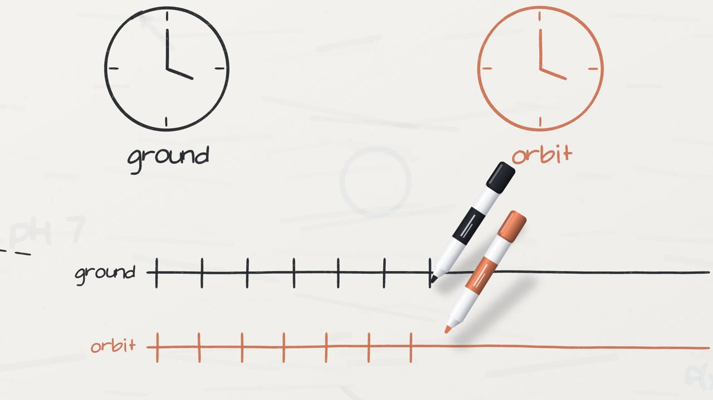</a><br><b>Whiteboard Explainer</b><br><sub>Whiteboard Explainer</sub><br><sub>Story Videos / Educational Explainers / Brand Shorts</sub><br><a href="styles/opuscar-whiteboard/STYLE.md">Style rules</a> · <a href="styles/opuscar-whiteboard/sample.mp4">Sample video</a></td>
</tr>
</table>

### East Asian Traditions · 4 Styles

<table>
<tr>
<td width="33%" valign="top"><a href="styles/opuscar-paper-lantern/STYLE.md">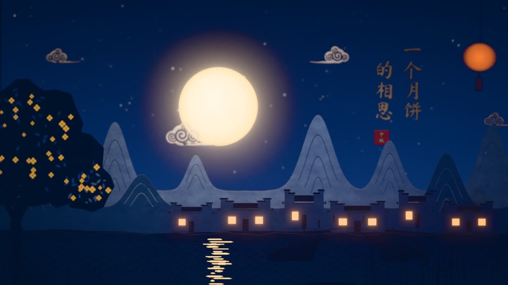</a><br><b>Paper-cut Lightbox</b><br><sub>Paper-cut Lightbox</sub><br><sub>Story Videos / Brand Shorts / Music & Visual Performance</sub><br><a href="styles/opuscar-paper-lantern/STYLE.md">Style rules</a> · <a href="styles/opuscar-paper-lantern/sample.mp4">Sample video</a></td>
<td width="33%" valign="top"><a href="styles/opuscar-papercut-red/STYLE.md"></a><br><b>Red Paper-cut</b><br><sub>Red Paper-cut</sub><br><sub>Story Videos / Brand Shorts / Music & Visual Performance</sub><br><a href="styles/opuscar-papercut-red/STYLE.md">Style rules</a> · <a href="styles/opuscar-papercut-red/sample.mp4">Sample video</a></td>
<td width="33%" valign="top"><a href="styles/opuscar-shadow-puppet/STYLE.md"></a><br><b>Shadow Puppetry</b><br><sub>Shadow Puppetry</sub><br><sub>Story Videos / Brand Shorts / Music & Visual Performance</sub><br><a href="styles/opuscar-shadow-puppet/STYLE.md">Style rules</a> · <a href="styles/opuscar-shadow-puppet/sample.mp4">Sample video</a></td>
</tr>
<tr>
<td width="33%" valign="top"><a href="styles/opuscar-ukiyoe/STYLE.md">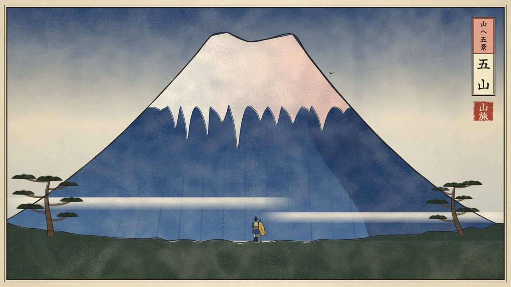</a><br><b>Ukiyo-e</b><br><sub>Ukiyo-e</sub><br><sub>Story Videos / Brand Shorts / Music & Visual Performance</sub><br><a href="styles/opuscar-ukiyoe/STYLE.md">Style rules</a> · <a href="styles/opuscar-ukiyoe/sample.mp4">Sample video</a></td>
</tr>
</table>

### Printing & Printmaking · 5 Styles

<table>
<tr>
<td width="33%" valign="top"><a href="styles/opuscar-engraving/STYLE.md">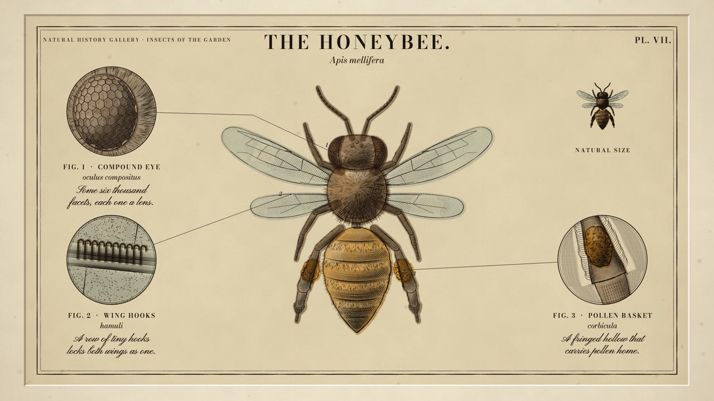</a><br><b>Copperplate Engraving</b><br><sub>Copperplate Engraving</sub><br><sub>News & Information / Story Videos / Brand Shorts</sub><br><a href="styles/opuscar-engraving/STYLE.md">Style rules</a> · <a href="styles/opuscar-engraving/sample.mp4">Sample video</a></td>
<td width="33%" valign="top"><a href="styles/opuscar-halftone-dossier/STYLE.md">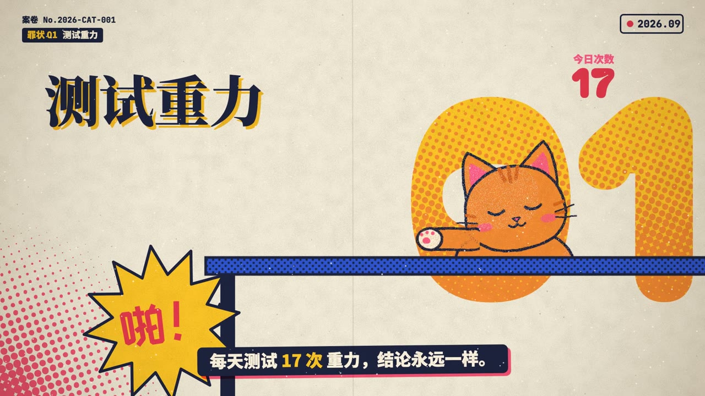</a><br><b>Halftone Dossier</b><br><sub>Halftone Dossier</sub><br><sub>News & Information / Story Videos / Brand Shorts</sub><br><a href="styles/opuscar-halftone-dossier/STYLE.md">Style rules</a> · <a href="styles/opuscar-halftone-dossier/sample.mp4">Sample video</a></td>
<td width="33%" valign="top"><a href="styles/opuscar-risograph/STYLE.md"></a><br><b>Risograph Print</b><br><sub>Risograph Print</sub><br><sub>News & Information / Story Videos / Brand Shorts</sub><br><a href="styles/opuscar-risograph/STYLE.md">Style rules</a> · <a href="styles/opuscar-risograph/sample.mp4">Sample video</a></td>
</tr>
<tr>
<td width="33%" valign="top"><a href="styles/opuscar-silkscreen-poster/STYLE.md">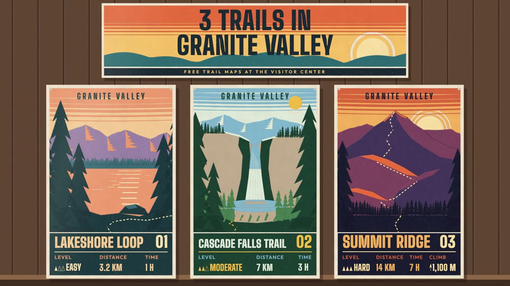</a><br><b>Silkscreen Travel Poster</b><br><sub>Silkscreen Travel Poster</sub><br><sub>News & Information / Story Videos / Brand Shorts</sub><br><a href="styles/opuscar-silkscreen-poster/STYLE.md">Style rules</a> · <a href="styles/opuscar-silkscreen-poster/sample.mp4">Sample video</a></td>
<td width="33%" valign="top"><a href="styles/opuscar-woodcut/STYLE.md">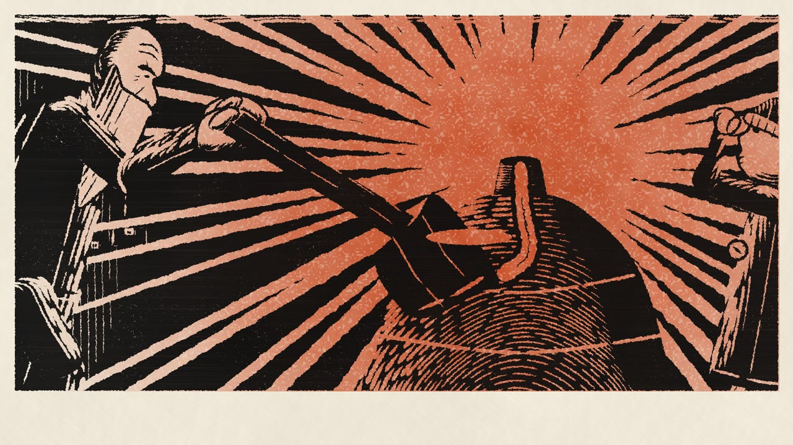</a><br><b>Woodcut Print</b><br><sub>Woodcut Print</sub><br><sub>News & Information / Story Videos / Brand Shorts</sub><br><a href="styles/opuscar-woodcut/STYLE.md">Style rules</a> · <a href="styles/opuscar-woodcut/sample.mp4">Sample video</a></td>
</tr>
</table>

### Graphics & Typography · 7 Styles

<table>
<tr>
<td width="33%" valign="top"><a href="styles/opuscar-art-deco/STYLE.md"></a><br><b>Art Deco</b><br><sub>Art Deco</sub><br><sub>Educational Explainers / Feature Animations / Brand Shorts</sub><br><a href="styles/opuscar-art-deco/STYLE.md">Style rules</a> · <a href="styles/opuscar-art-deco/sample.mp4">Sample video</a></td>
<td width="33%" valign="top"><a href="styles/opuscar-ascii-crt/STYLE.md">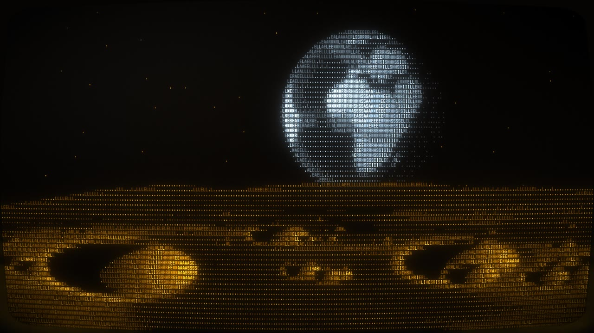</a><br><b>ASCII / CRT Terminal</b><br><sub>ASCII / CRT Terminal</sub><br><sub>Educational Explainers / Feature Animations / Brand Shorts</sub><br><a href="styles/opuscar-ascii-crt/STYLE.md">Style rules</a> · <a href="styles/opuscar-ascii-crt/sample.mp4">Sample video</a></td>
<td width="33%" valign="top"><a href="styles/opuscar-blueprint/STYLE.md">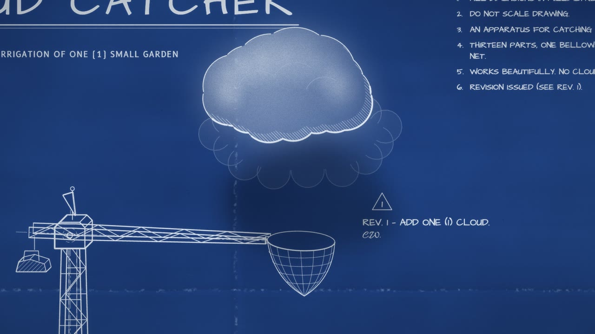</a><br><b>Blueprint</b><br><sub>Blueprint</sub><br><sub>Educational Explainers / Feature Animations / Brand Shorts</sub><br><a href="styles/opuscar-blueprint/STYLE.md">Style rules</a> · <a href="styles/opuscar-blueprint/sample.mp4">Sample video</a></td>
</tr>
<tr>
<td width="33%" valign="top"><a href="styles/opuscar-pictogram-motion/STYLE.md">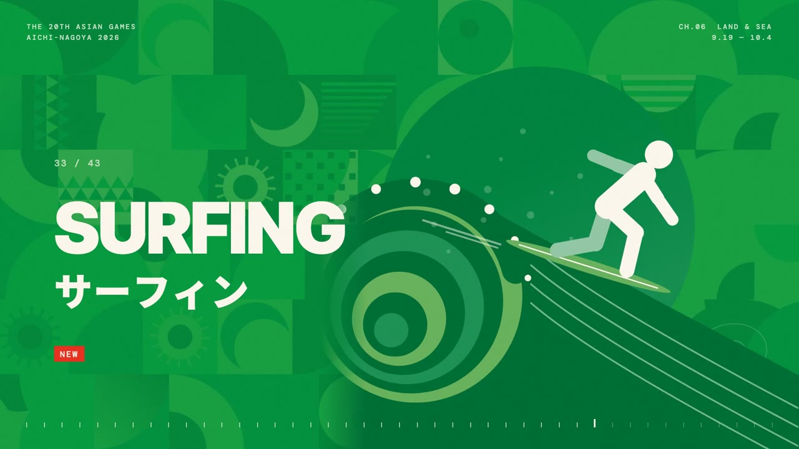</a><br><b>Pictogram Motion</b><br><sub>Pictogram Motion</sub><br><sub>Educational Explainers / Feature Animations / Brand Shorts</sub><br><a href="styles/opuscar-pictogram-motion/STYLE.md">Style rules</a> · <a href="styles/opuscar-pictogram-motion/sample.mp4">Sample video</a></td>
<td width="33%" valign="top"><a href="styles/opuscar-spy-titles/STYLE.md">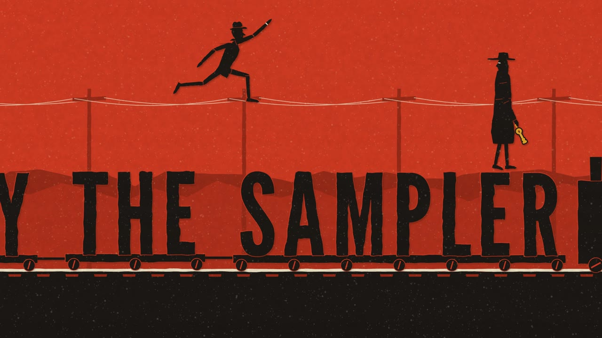</a><br><b>60s Spy Title Sequence</b><br><sub>60s Spy Title Sequence</sub><br><sub>Educational Explainers / Feature Animations / Brand Shorts</sub><br><a href="styles/opuscar-spy-titles/STYLE.md">Style rules</a> · <a href="styles/opuscar-spy-titles/sample.mp4">Sample video</a></td>
<td width="33%" valign="top"><a href="styles/opuscar-stained-glass/STYLE.md">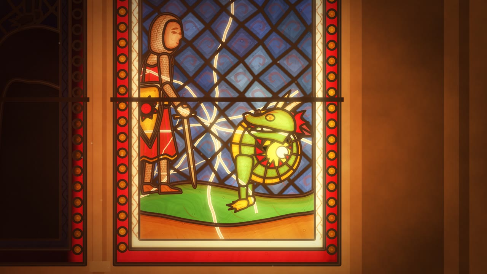</a><br><b>Stained Glass</b><br><sub>Stained Glass</sub><br><sub>Educational Explainers / Feature Animations / Brand Shorts</sub><br><a href="styles/opuscar-stained-glass/STYLE.md">Style rules</a> · <a href="styles/opuscar-stained-glass/sample.mp4">Sample video</a></td>
</tr>
<tr>
<td width="33%" valign="top"><a href="styles/opuscar-swiss-motion/STYLE.md">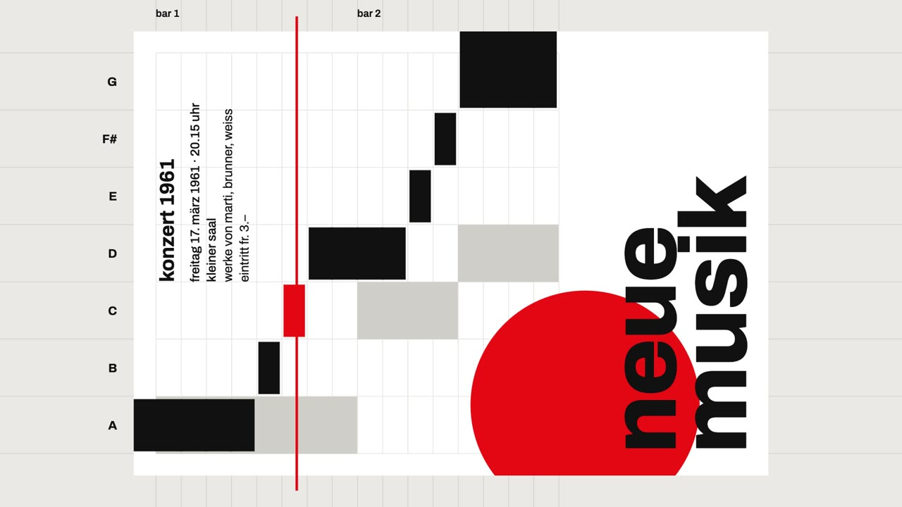</a><br><b>Swiss Motion Graphics</b><br><sub>Swiss Motion Graphics</sub><br><sub>Educational Explainers / Feature Animations / Brand Shorts</sub><br><a href="styles/opuscar-swiss-motion/STYLE.md">Style rules</a> · <a href="styles/opuscar-swiss-motion/sample.mp4">Sample video</a></td>
</tr>
</table>

### Information & Launches · 5 Styles

<table>
<tr>
<td width="33%" valign="top"><a href="styles/opuscar-dark-keynote/STYLE.md">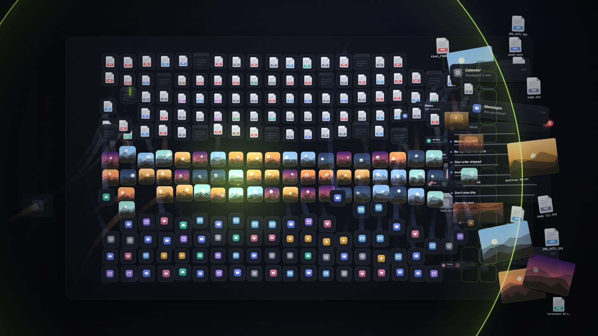</a><br><b>Dark Tech Keynote</b><br><sub>Dark Tech Keynote</sub><br><sub>Product Demos / Educational Explainers / News & Information</sub><br><a href="styles/opuscar-dark-keynote/STYLE.md">Style rules</a> · <a href="styles/opuscar-dark-keynote/sample.mp4">Sample video</a></td>
<td width="33%" valign="top"><a href="styles/opuscar-dataviz/STYLE.md">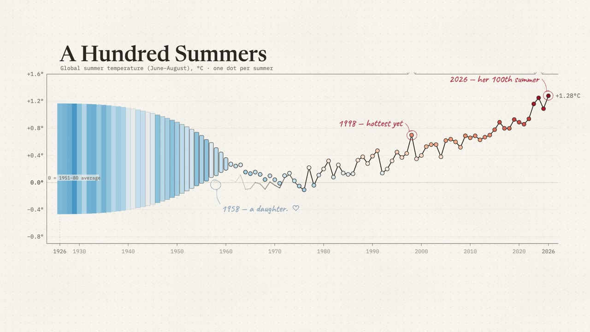</a><br><b>Data Storytelling</b><br><sub>Data Storytelling</sub><br><sub>Product Demos / Educational Explainers / News & Information</sub><br><a href="styles/opuscar-dataviz/STYLE.md">Style rules</a> · <a href="styles/opuscar-dataviz/sample.mp4">Sample video</a></td>
<td width="33%" valign="top"><a href="styles/opuscar-hologram-hud/STYLE.md">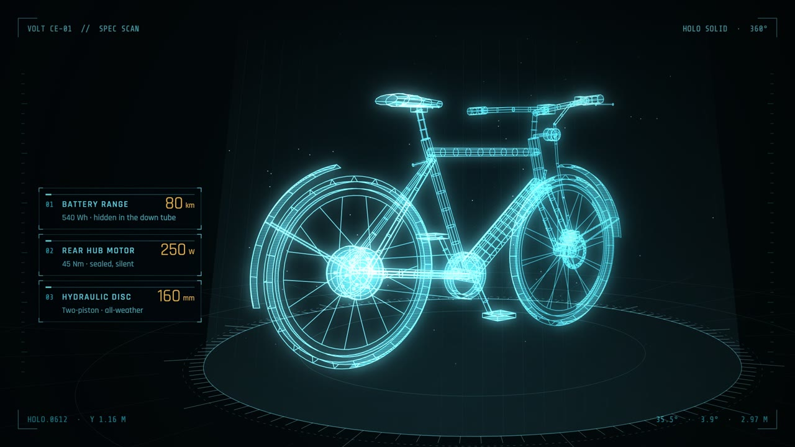</a><br><b>Sci-fi Hologram HUD</b><br><sub>Sci-fi Hologram HUD</sub><br><sub>Product Demos / Educational Explainers / News & Information</sub><br><a href="styles/opuscar-hologram-hud/STYLE.md">Style rules</a> · <a href="styles/opuscar-hologram-hud/sample.mp4">Sample video</a></td>
</tr>
<tr>
<td width="33%" valign="top"><a href="styles/opuscar-iso-infographic/STYLE.md">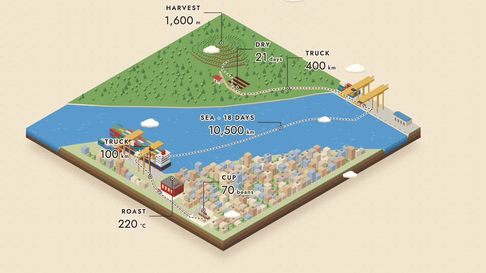</a><br><b>Isometric Infographic</b><br><sub>Isometric Infographic</sub><br><sub>Product Demos / Educational Explainers / News & Information</sub><br><a href="styles/opuscar-iso-infographic/STYLE.md">Style rules</a> · <a href="styles/opuscar-iso-infographic/sample.mp4">Sample video</a></td>
<td width="33%" valign="top"><a href="styles/opuscar-living-screencast/STYLE.md">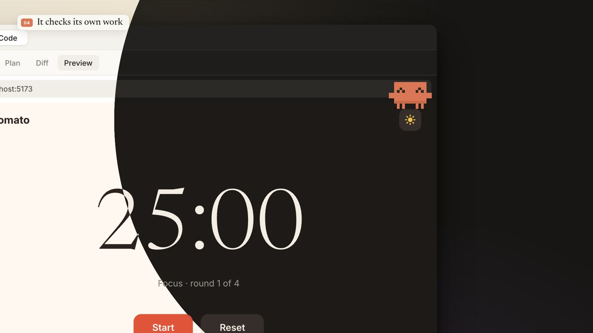</a><br><b>Living Screencast</b><br><sub>Living Screencast</sub><br><sub>Product Demos / Educational Explainers / News & Information</sub><br><a href="styles/opuscar-living-screencast/STYLE.md">Style rules</a> · <a href="styles/opuscar-living-screencast/sample.mp4">Sample video</a></td>
</tr>
</table>

### Cartoons & Animation · 4 Styles

<table>
<tr>
<td width="33%" valign="top"><a href="styles/opuscar-cel-anime-80s/STYLE.md">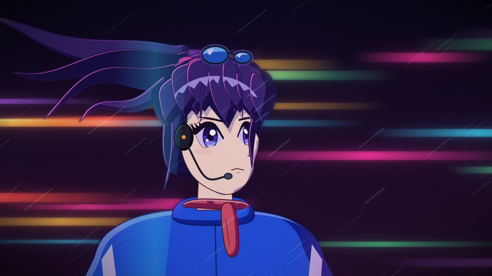</a><br><b>80s Cel Anime</b><br><sub>80s Cel Anime</sub><br><sub>Story Videos / Educational Explainers / Music & Visual Performance</sub><br><a href="styles/opuscar-cel-anime-80s/STYLE.md">Style rules</a> · <a href="styles/opuscar-cel-anime-80s/sample.mp4">Sample video</a></td>
<td width="33%" valign="top"><a href="styles/opuscar-midcentury-toon/STYLE.md">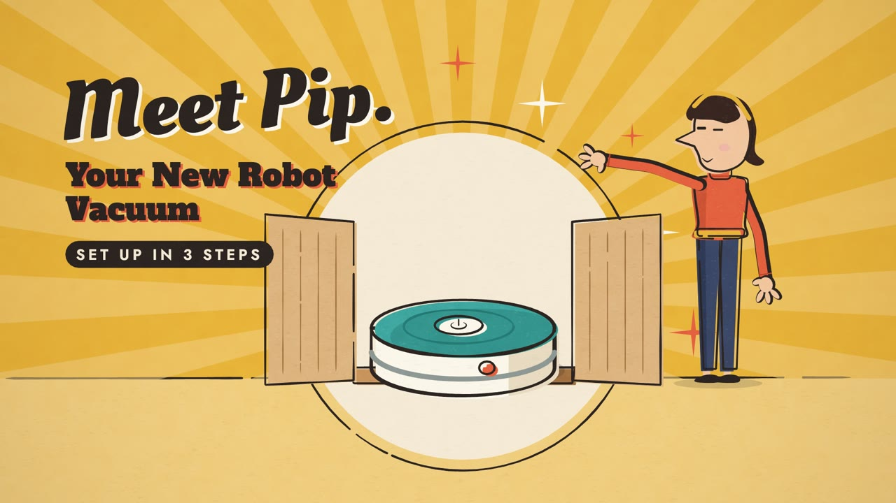</a><br><b>Mid-century Cartoon</b><br><sub>Mid-century Cartoon</sub><br><sub>Story Videos / Educational Explainers / Music & Visual Performance</sub><br><a href="styles/opuscar-midcentury-toon/STYLE.md">Style rules</a> · <a href="styles/opuscar-midcentury-toon/sample.mp4">Sample video</a></td>
<td width="33%" valign="top"><a href="styles/opuscar-rubber-hose/STYLE.md">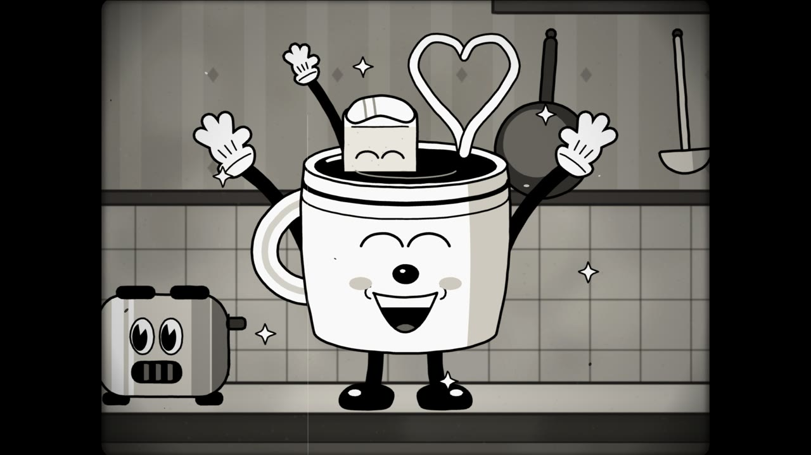</a><br><b>1930s Rubber Hose Cartoon</b><br><sub>1930s Rubber Hose Cartoon</sub><br><sub>Story Videos / Educational Explainers / Music & Visual Performance</sub><br><a href="styles/opuscar-rubber-hose/STYLE.md">Style rules</a> · <a href="styles/opuscar-rubber-hose/sample.mp4">Sample video</a></td>
</tr>
<tr>
<td width="33%" valign="top"><a href="styles/opuscar-scifi-toon/STYLE.md">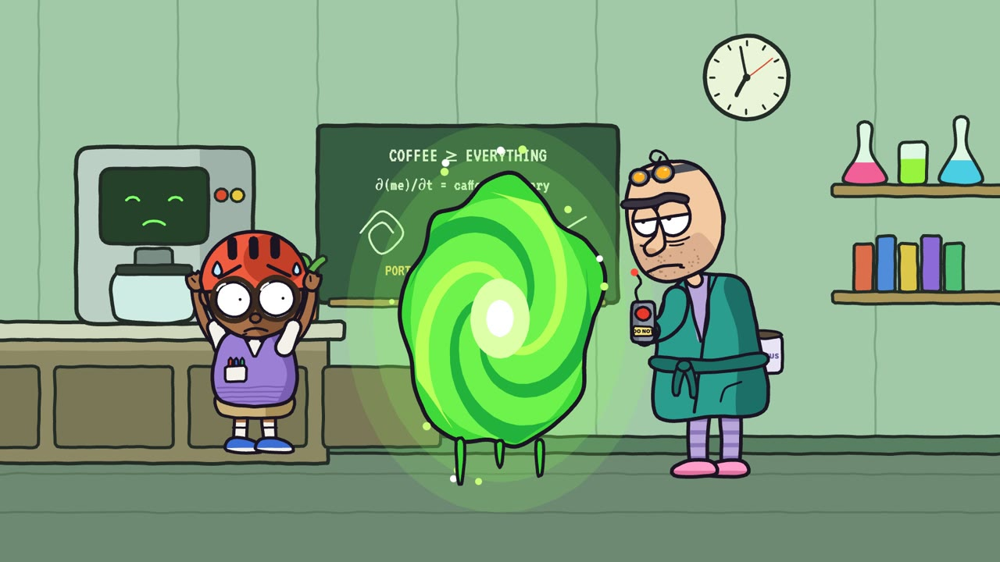</a><br><b>Sci-Fi Sitcom Toon</b><br><sub>Sci-Fi Sitcom Toon</sub><br><sub>Story Videos / Educational Explainers / Music & Visual Performance</sub><br><a href="styles/opuscar-scifi-toon/STYLE.md">Style rules</a> · <a href="styles/opuscar-scifi-toon/sample.mp4">Sample video</a></td>
</tr>
</table>

### Games · 4 Styles

<table>
<tr>
<td width="33%" valign="top"><a href="styles/opuscar-game-show/STYLE.md">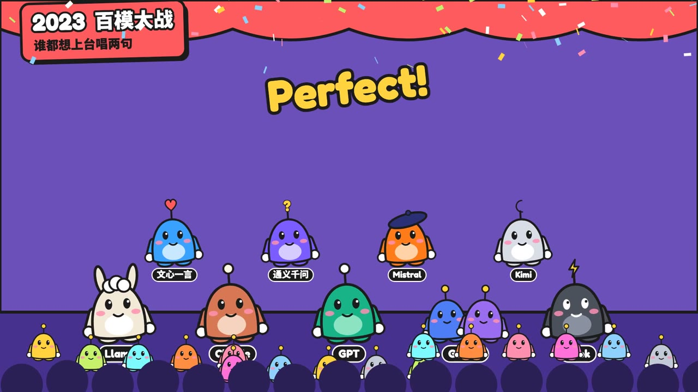</a><br><b>Game Show Flat</b><br><sub>Game Show Flat</sub><br><sub>Story Videos / Educational Explainers / Music & Visual Performance</sub><br><a href="styles/opuscar-game-show/STYLE.md">Style rules</a> · <a href="styles/opuscar-game-show/sample.mp4">Sample video</a></td>
<td width="33%" valign="top"><a href="styles/opuscar-hd-2d/STYLE.md">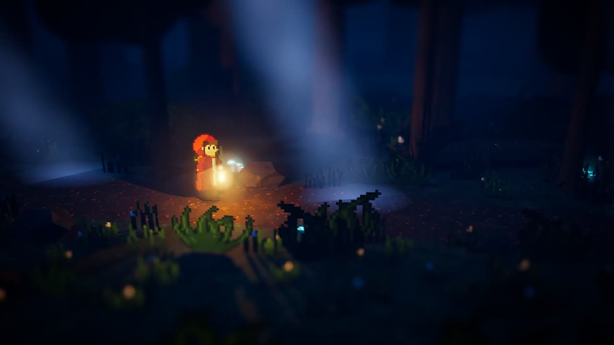</a><br><b>HD-2D</b><br><sub>HD-2D</sub><br><sub>Story Videos / Educational Explainers / Music & Visual Performance</sub><br><a href="styles/opuscar-hd-2d/STYLE.md">Style rules</a> · <a href="styles/opuscar-hd-2d/sample.mp4">Sample video</a></td>
<td width="33%" valign="top"><a href="styles/opuscar-microgame/STYLE.md">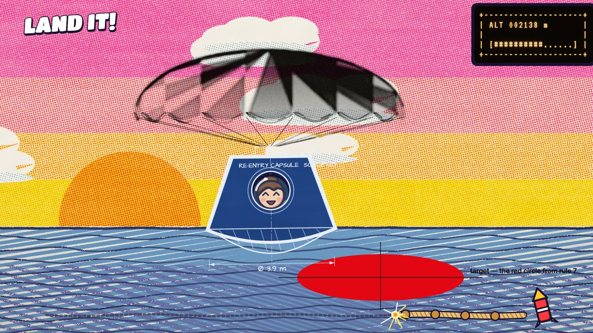</a><br><b>Microgame Frenzy</b><br><sub>Microgame Frenzy</sub><br><sub>Story Videos / Educational Explainers / Music & Visual Performance</sub><br><a href="styles/opuscar-microgame/STYLE.md">Style rules</a> · <a href="styles/opuscar-microgame/sample.mp4">Sample video</a></td>
</tr>
<tr>
<td width="33%" valign="top"><a href="styles/opuscar-pixel-rpg/STYLE.md">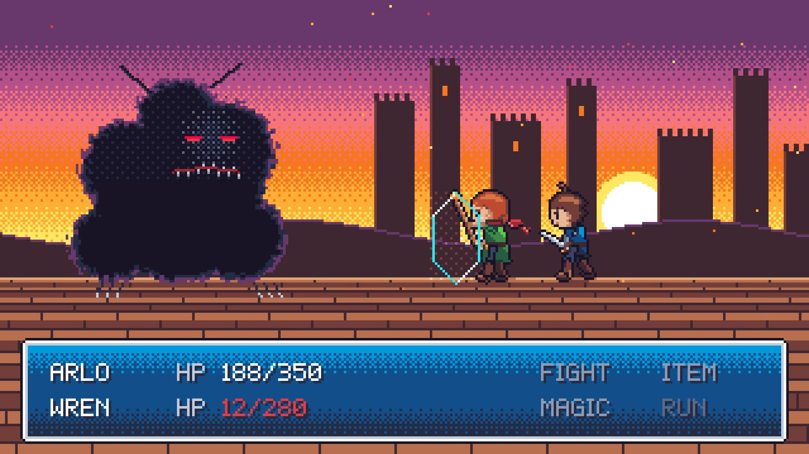</a><br><b>16-bit Pixel RPG</b><br><sub>16-bit Pixel RPG</sub><br><sub>Story Videos / Educational Explainers / Music & Visual Performance</sub><br><a href="styles/opuscar-pixel-rpg/STYLE.md">Style rules</a> · <a href="styles/opuscar-pixel-rpg/sample.mp4">Sample video</a></td>
</tr>
</table>

### Film & Period Styles · 2 Styles

<table>
<tr>
<td width="33%" valign="top"><a href="styles/opuscar-backrooms/STYLE.md">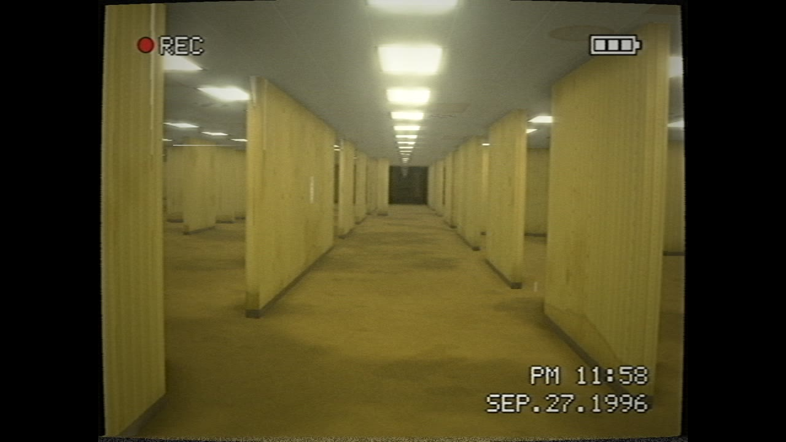</a><br><b>Liminal Found Footage</b><br><sub>Liminal Found Footage</sub><br><sub>Story Videos / Brand Shorts / Music & Visual Performance</sub><br><a href="styles/opuscar-backrooms/STYLE.md">Style rules</a> · <a href="styles/opuscar-backrooms/sample.mp4">Sample video</a></td>
<td width="33%" valign="top"><a href="styles/opuscar-silent-film/STYLE.md">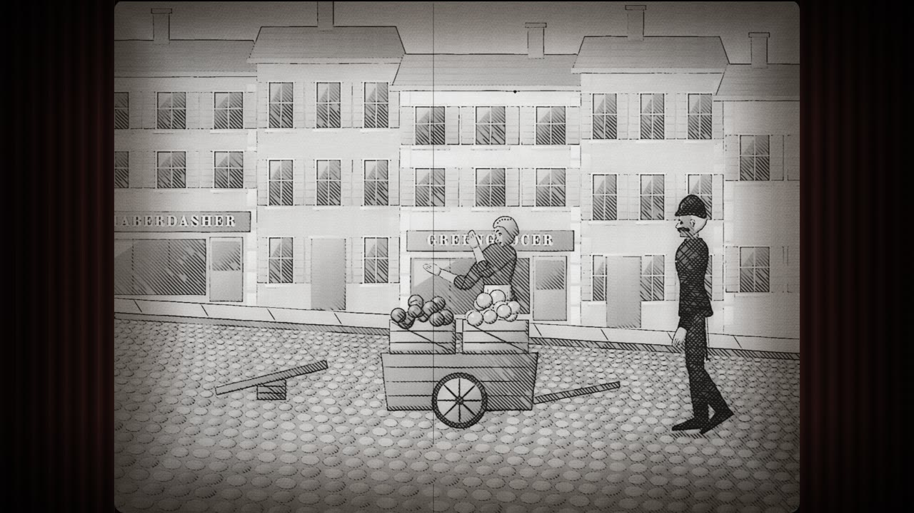</a><br><b>1920s Silent Film</b><br><sub>1920s Silent Film</sub><br><sub>Story Videos / Brand Shorts / Music & Visual Performance</sub><br><a href="styles/opuscar-silent-film/STYLE.md">Style rules</a> · <a href="styles/opuscar-silent-film/sample.mp4">Sample video</a></td>
</tr>
</table>

### Materials & 3D · 5 Styles

<table>
<tr>
<td width="33%" valign="top"><a href="styles/opuscar-brick-toy/STYLE.md"></a><br><b>Brick Toy</b><br><sub>Brick Toy</sub><br><sub>Product Demos / Brand Shorts / Music & Visual Performance</sub><br><a href="styles/opuscar-brick-toy/STYLE.md">Style rules</a> · <a href="styles/opuscar-brick-toy/sample.mp4">Sample video</a></td>
<td width="33%" valign="top"><a href="styles/opuscar-glass-product/STYLE.md"></a><br><b>Glass Product Render</b><br><sub>Glass Product Render</sub><br><sub>Product Demos / Brand Shorts / Music & Visual Performance</sub><br><a href="styles/opuscar-glass-product/STYLE.md">Style rules</a> · <a href="styles/opuscar-glass-product/sample.mp4">Sample video</a></td>
<td width="33%" valign="top"><a href="styles/opuscar-lowpoly-island/STYLE.md"></a><br><b>Low-poly Isometric Island</b><br><sub>Low-poly Isometric Island</sub><br><sub>Product Demos / Brand Shorts / Music & Visual Performance</sub><br><a href="styles/opuscar-lowpoly-island/STYLE.md">Style rules</a> · <a href="styles/opuscar-lowpoly-island/sample.mp4">Sample video</a></td>
</tr>
<tr>
<td width="33%" valign="top"><a href="styles/opuscar-paper-popup/STYLE.md"></a><br><b>Paper Pop-up Book</b><br><sub>Paper Pop-up Book</sub><br><sub>Product Demos / Brand Shorts / Music & Visual Performance</sub><br><a href="styles/opuscar-paper-popup/STYLE.md">Style rules</a> · <a href="styles/opuscar-paper-popup/sample.mp4">Sample video</a></td>
<td width="33%" valign="top"><a href="styles/opuscar-tilt-shift/STYLE.md"></a><br><b>Tilt-Shift Miniature</b><br><sub>Tilt-Shift Miniature</sub><br><sub>Product Demos / Brand Shorts / Music & Visual Performance</sub><br><a href="styles/opuscar-tilt-shift/STYLE.md">Style rules</a> · <a href="styles/opuscar-tilt-shift/sample.mp4">Sample video</a></td>
</tr>
</table>

<a id="怎样把这些能力组合起来"></a>
## How to Combine These Capabilities

The scenario defines the task; the style determines material and visual language; the recipe structures the complete video; expression techniques and animations handle local details. Combine them to suit the subject.

| Desired Work | Possible Starting Point |
| --- | --- |
| Product launch video | Product task proof + Product Minimal or Glass Product style + action callouts + result reveal |
| Concept explainer | Progressive explanation + Mono Diagram or Isometric Infographic + narration or music direction |
| Hip-hop explainer | Verified facts and lyrics + pixel or game-show rhythm + line-by-line captions synced to the actual track |
| News short | Evidence board + Caption News or Broadcast News Package + original sources and data |
| Photo or brand short | Real photos as primary visuals + Cinematic Photo or Vivid Collage + musical motifs and transitions |

### 18 Composition Recipes

These recipes are arrangements developed from creative research and practice. Each describes inputs, shot steps, technique combinations, checks, and adjustments.

| Recipe | How It Organizes Content |
| --- | --- |
| [One Interface Object's Journey](catalog/recipes.json) | Follow an interface object through multiple states while preserving spatial and action continuity. |
| [Follow a Signal Through a System](catalog/recipes.json) | Track a signal or unit of information to explain its path and transformations. |
| [From the Whole to the Microscopic](catalog/recipes.json) | Move from the whole to details and microscopic views, establishing scale references in layers. |
| [Real Photo to Hero Visual](catalog/recipes.json) | Preserve the photo's subject and use cropping, layout, and camera framing to highlight it. |
| [Make Musical Events Visible](catalog/recipes.json) | Translate musical events into visible actions and changes. |
| [Typography as Narrative Action](catalog/recipes.json) | Let the appearance, position, and motion of text advance the story. |
| [Explain Differences with Data](catalog/recipes.json) | Establish a common baseline, then show values, relationships, and differences. |
| [Purposeful Brand Film](catalog/recipes.json) | Develop a recurring visual motif around the brand proposition. |
| [Prove Product Value with a Real Task](catalog/recipes.json) | Begin with the user's task, show real actions, and conclude with visible results. |
| [Layer Capabilities into One Clip](catalog/recipes.json) | Add changes progressively to the same clip so differences remain comparable. |
| [Object-as-Explanation](catalog/recipes.json) | Explain a mechanism through the object's structure, location, and operation. |
| [Progressive Abstract Concept Explainer](catalog/recipes.json) | Establish a visual carrier and relationships first, then introduce information in layers. |
| [Evidence Board for News](catalog/recipes.json) | Organize documents, facts, and comparisons into a clear news narrative. |
| [Launch Video Emotional Arc](catalog/recipes.json) | Pace a launch around the problem, turning point, proof, and action. |
| [Linked Feature Chapters](catalog/recipes.json) | Present a group of related features through connected chapters. |
| [Product Music Narrative](catalog/recipes.json) | Coordinate product actions, lyrics, musical sections, and visual changes. |
| [Concept Knowledge Explainer](catalog/recipes.json) | Organize layers of knowledge, keywords, captions, and reveals around chosen music. |
| [Hip-Hop Knowledge Explainer](catalog/recipes.json) | Turn verified knowledge into performable lyrics, then synchronize image and sound to the real track. |

### 64 Expression Techniques

These techniques are synthesized and adapted here to describe a local device's purpose, inputs, parameters, and checks. Full details are available in the [Expression Catalog](assets/gallery/expressions.html).

| Category | Included Techniques |
| --- | --- |
| Narrative · 9 | Goal to evidence; follow one information unit; continuous scale explanation; rise and fall of visual energy; one subject through changes; pain-point-to-verdict evidence ladder; finished output as evidence with excerpts labeled; parallel promise chapters; action as invocation |
| Camera · 4 | Push in and pull back for context; route-guided camera; motion-compensated composition; pullback reveal and click-through traversal |
| Transitions · 6 | Shared-shape transition; composition-matched cut; occlusion reveal; object breaking the frame; tangential off-track continuity; action-and-causality seam |
| Visuals · 9 | Link action to measurement; spatial media array; structural disassembly and reassembly; controlled particle field; continuous material transition; target box and semantic callout; bounded processing and result reveal; magnitude whip-pan with digit-by-digit counting; recreated interface with recognizable shell |
| Animation · 4 | Goal-directed elastic settle; differential stretch between leading and trailing edges; path growth and flow; fill and transfer |
| Typography · 6 | Semantically changing text emphasis; text along a curve; letter-orientation compensation; read before motion; typing narrator; verdict card and three voices |
| Sound · 5 | Music beat mapping; visible events triggering sound; frequency-band-responsive visuals; prioritize the main sound; beat-aligned turning point and shallow transition valley |
| Interaction · 2 | Visible direct manipulation; turn interaction experience into a guided tour |
| Style Consistency · 2 | Unified visual and motion character; two-background-color world |
| Production Organization · 6 | Locatable unified timeline; seamless beginning-to-end loop; lock relationships and rhythm before reskinning; capability detection and trustworthy fallback; internal-clock compression; hold-time budget |
| Knowledge Communication · 11 | Object-as-explanation; progressive layering; bridges between layers; four questions for introducing parts; one complete run; counterfactual probe; grounded labels; truth ledger; controlled expression; evidence board; model limits and further guidance |

### 12 Basic Animation Types

Entrance · Exit · Emphasis · Path drawing · Relationship building · Value change · State replacement · Camera focus · Mask transition · Staggered reveal · Layer parallax · Stable hold

Recipes, techniques, and animations provide design and implementation guidance; the available project and tools create the actual visuals. Browse and extend them through the [Catalog](catalog/).

## Additional Engineering & Usage Features

| Capability | How to Use It |
| --- | --- |
| Precise style selection | Search by canonical ID, Chinese name, or English name; review rules before production |
| New and derived styles | Create an independent pack, extend a base, and declare selective reuse as needed |
| Project and personal collections | Keep personal variants in external collections excluded from generated built-in indexes |
| Visual selection | Search, filter, and compare styles side by side in the gallery; copy style IDs or creative instructions |
| Offline sample playback | Representative frames and 59 samples ship with the repository for local browsing |
| Automatic catalog generation | Style metadata generates indexes and galleries, updated together after adding packs |
| File and dependency checks | Detect naming collisions, missing references, dependency cycles, file changes, and plan locks |
| Media and delivery checks | Probe real video/audio, check schedules, captions, sound events, and delivery files |

```sh
python3 scripts/stylepacks.py resolve 中国水墨
python3 scripts/stylepacks.py init brand-ink --into /project/video/styles --extends opuscar-ink-wash
python3 scripts/stylepacks.py validate --style-root /project/video/styles
```

See [Maintenance](MAINTAINING.md) and the [Style Pack Contract](references/style-pack-contract.md) for extension rules. Engineering practices such as separating directing from technical implementation, and style rules from examples, were informed by Lemo-Opuscar; this repository retains its own delivery approach, contracts, and tool interfaces.

## Method References & Community Support

Besides the fully integrated Lemo-Opuscar styles, this repository draws inspiration from the following projects and creative studies, developing its own orchestration and validation rules.

| Reference Project | Influence on This Repository |
| --- | --- |
| [huashu-design](https://github.com/alchaincyf/huashu-design) | Direction, storyboards, keyframes, and audio reviews |
| [guizang-ppt-skill](https://github.com/op7418/guizang-ppt-skill) | Content slots, styles, and layout organization |
| [OpenDesign](https://github.com/nexu-io/open-design) | Viewer outcomes, focus, transformations, and holds |
| [guizang-social-card-skill](https://github.com/op7418/guizang-social-card-skill) | Placing content and evidence in frame; first frames and short motion |
| [guizang-product-video-skill](https://github.com/op7418/guizang-product-video-skill) | Product tasks, real components, and narration timing |
| [HyperFrames launches](https://github.com/heygen-com/hyperframes-launches) | Product task proof, launch organization, and audiovisual direction |
| [awesome-opus5-5-videos](https://github.com/yihui-dev/awesome-opus5-5-videos) | Research into motifs, prompt descriptions, and relationships between works |

These projects provided methodological inspiration. The repository's synthesis, contracts, and adaptation relationships are recorded in the [Sources](references/sources.md) and individual entries' provenance fields. Thanks to their creators for sharing.

## Installation

Clone the repository into a Skill directory that your Agent can load. For example, in Codex, run the following command if the target directory does not already exist:

```sh
git clone https://github.com/mileson/chaojifeng-video-design.git ~/.codex/skills/chaojifeng-video-design
```

If a Skill with the same name already exists, inspect your changes and private assets first to avoid overwriting them. Other Agents that support `SKILL.md` can place the full folder in their corresponding Skill directories while preserving relative paths.

<a id="开始使用"></a>
## Getting Started

Invoke `$chaojifeng-video-design` in your Agent and describe the goal. Here are some examples.

The shortest form is:

> Use $chaojifeng-video-design to create a concept explainer about [TOPIC], and finish it end to end in one pass.

You can also specify music:

> Use $chaojifeng-video-design to produce a concept explainer about [TOPIC] using my provided [MUSIC FILE]. Arrange it around the track's structure and deliver the finished video directly.

> Produce a 30-second vertical introduction to this product. Use existing project screenshots and assets; first identify the task we need to prove, then complete the shots, sound, final video, and necessary editable sources.

> Turn these images into a 20-second video, preserving their subjects and planning visual focus and transitions. Use the licensed track I provided.

> Only modify shot 3 to make the operation result easier to see, then recheck associated captions and sound cues.

> I only need a storyboard plan. First verify the facts of the TCP three-way handshake, then explain it visually through progressive layers.

The Agent selects an implementation based on the existing project and available tools. This repository includes creative methods, contracts, examples, and validation scripts. Generation, rendering, voice synthesis, and export require capabilities supplied by the host environment. It does not include a universal video renderer or require a fixed model or engine.

When explicitly instructed to “complete in one pass,” “deliver the finished video directly,” or “skip test previews,” the Agent should proceed through production, internal checks, and necessary revisions without pausing. For staged reviews, it waits at agreed checkpoints. You can also request only a plan, storyboard, or targeted edit.

## Browse & Validate

Run these from the repository root. Catalog queries and contract-validation scripts use Python 3.10+ and the standard library; media probing and certain tests also need FFmpeg and ffprobe installed. No third-party Python packages are required.

```sh
python3 scripts/catalog.py --kind scenario list
python3 scripts/catalog.py --kind recipe get product-task-proof
python3 scripts/catalog.py --kind expression get visual.target-callout
python3 scripts/validate_plan.py examples/product-demo.plan.json
python3 -m unittest discover -s scripts -p 'test_*.py'
```

Open the [Style Gallery](assets/gallery/index.html) to browse all 66 styles through representative images, search by category or video task, compare side by side, and copy creative instructions for selected styles. The 59 representative frames are embedded in HTML, while all 59 sample videos ship with the repository and play offline after a complete download. Core styles reflect their actual parameters. For motion and recipes, use the [Expression Catalog](assets/gallery/expressions.html). You can also read the [Skill Entry Point](SKILL.md), [Plan Contract](references/plan-contract.md), and [Runtime & Delivery](references/runtime-and-delivery.md). Galleries and sample plans help explain and validate structure; actual work still requires rendering, viewing, and listening.

## Music & Sound

The “Concept Knowledge Explainer” recipe supports **one music pool, multiple candidates, and one default track**. Selection priority is: explicitly specified by user → already selected in project → current recipe default. Adding a candidate and changing the default are separate actions; a one-off selection affects only the current work. After changing tracks, reanalyze actual sections, beats, and timing mappings rather than reusing conclusions from the previous track.

The current [Music Catalog](catalog/music.json) retains metadata for the track identified as “知识分享背景音乐神曲” (a popular knowledge-sharing background track) as the initial default reference. No audio file is included. Before using the default, associate an authorized copy of the exact file with the local location registry; scripts will verify its hash and real duration. Or specify your own file directly without modifying the music pool:

```sh
python3 scripts/music_library.py search --recipe knowledge-music-explainer --limit 5
python3 scripts/music_library.py select --recipe knowledge-music-explainer --source-file /project/music/chosen.wav
```

Other recipes choose music according to their configuration and task. Follow [Music Direction](references/music-direction.md) to add tracks and clips you are licensed to use; record actual file hashes, duration, origin, and permitted use. Source locations are linked through project-local `*.local.json` files or `CJF_VIDEO_MUSIC_REGISTRY` and are not committed to the repository.

```sh
python3 scripts/music_library.py validate-catalog
python3 scripts/music_library.py search --scenario product-demo --emotion curious --role establish --limit 5
python3 scripts/build_music_atlas.py
```

Regenerate the atlas after adding tracks; importing a source-location registry alone does not add catalog entries. When the default audio is missing or its hash changes, the selection tool reports the exact problem rather than silently switching tracks.

[Concept Knowledge Explainer Direction](references/knowledge-music-direction.md) covers musical maps, caption/narration paths, reading windows, and sound cues. The optional [Audiovisual Cue Sheet](templates/knowledge-music-score.json) uses `explainer_timing_audit.py` to check declared reading windows and time mappings. Structural validation does not replace beat analysis, continuous viewing, or listening review.

Users supply their own narration references. Follow [Explainer Narration & Voice References](references/explainer-narration.md) to check rights, denoised derivatives, script accuracy, and actual listening quality. The repository includes the 59 style sample videos described above; private voices, separately licensed commercial songs, and model weights must be provided by the user.

## Directory Structure

| Location | Contents |
| --- | --- |
| `SKILL.md` | Lightweight entry point and task routing |
| `DIRECTOR.md` / `TECHNIQUE.md` | Directing methods and adaptation to production capabilities |
| `MAINTAINING.md` | Extension, import, generation, and regression checks |
| `styles/` | Independent style packs, full style rules, and example source files |
| `vendor/lemo-opuscar/` | Pinned shared text sources, licenses, and hash manifest |
| `references/` | Directing, knowledge communication, shots, sound, and acceptance criteria |
| `catalog/` | Scenario, style, animation, technique, and recipe catalogs |
| `templates/` | Plans, delivery records, audio event sheets, and other templates |
| `examples/` | Plans, example knowledge-package structures, and finished works |
| `scripts/` | Queries, validation, media probing, gallery generation, and offline tests |
| `assets/` | Visual style gallery, animation and recipe catalog, and music atlas |
| `evals/` | Creative evaluation prompts not yet run |

Passing automated checks establishes only that the corresponding structure or measurements meet the specified conditions. Visual quality, listening quality, factual correctness, and viewer comprehension must be assessed separately. Unperformed checks remain explicitly unverified.

## License & Attribution

Original code, documentation, templates, and gallery code in this repository are released under the [MIT License](LICENSE). Integrated Lemo-Opuscar code and documentation retain their MIT license; the 59 sample videos and representative frames use CC BY 4.0. See [Third-Party Notices](THIRD_PARTY_NOTICES.md) for individual attribution and changes to the three muted samples.

See [Showcase Notes](examples/showcase/README.md#使用范围) for permitted uses of the two creative examples. Other fonts, music, models, and assets are subject to their own terms.
